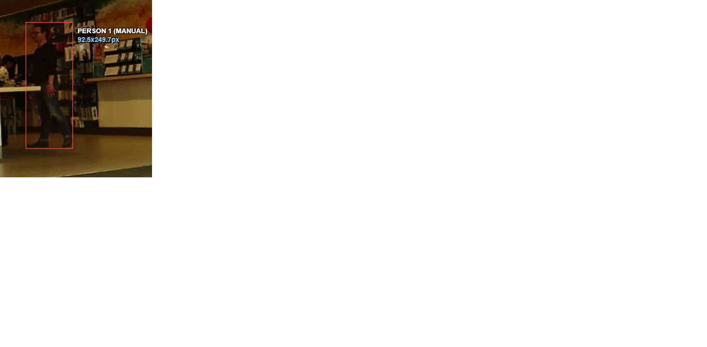
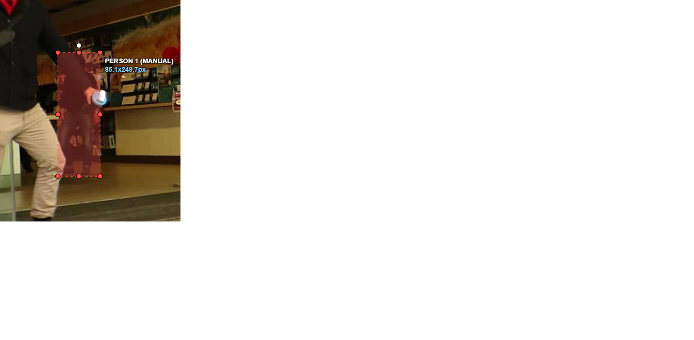
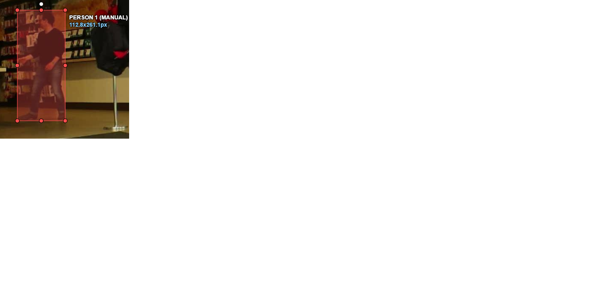

# Báo cáo cá nhân — HoVaTen-MSSV

Đổi tên file theo quy tắc `MSSV_HoTen.md`. Ví dụ: `20241234_NguyenVanAn.md`.

Đoạn video: MOT17-09, 150 frame (frame 1–150), nguồn MOTChallenge, giấy phép CC BY-NC-SA 3.0.

## 0. Thông tin học viên

- Họ tên: Đinh Đức Hiếu
- MSSV: 2A202603327
- Mã đề (A/B/C): **A** (P1–P5 = ID gốc MOT17-09: 1, 7, 19, 20, 21)
- Email: dinhduchieu60@gmail.com
- Link repository: https://github.com/hieudd04268/K5-L2-DAY05-DinhDucHieu-2A202603327-MOTTracking
- Giờ bắt đầu: 4 giờ 30 phút 
- Giờ kết thúc: 9 giờ 30 phút

Bảng đối chiếu người ↔ track ID trên CVAT (task `DAY05-MOT17-09-A-…`, job 10):

| Mã | `track_id` trong `gt.txt` | Mô tả nhận diện |
|---|---:|---|
| P1 | 1 | Nam áo len đen, quần jean, trong shop Vodafone, sau quầy |
| P2 | 5 | Nữ áo trắng-cam, trong shop Vodafone bên trái, sau kính |
| P3 | 2 | Bà cụ áo khoác xanh lá, túi đen, trước Woolworths |
| P4 | 4 | Ông đội mũ trắng, áo sơ mi xanh dương, vào từ mép phải |
| P5 | 3 | Bé gái áo trắng, đứng cạnh người phụ nữ áo xám trước Woolworths |

## 1. Xem trước đoạn video (CP0)

Ghi **trước khi vẽ**, mỗi người một dòng.

Frame tính theo CVAT (0–149).

| Mã | Frame xuất hiện | Frame cuối thấy được | Rẽ / dừng / đổi tốc độ ở frame | Bị che ở frame | Ghi chú |
|---|---|---|---|---|---|
| P1 | 0 | 149 | Đi sang phải 0–40; sau khi hiện lại đi sang phải rồi hướng về camera ~80–149 | ~28–55 (người áo khoác đen đi ngang) | Sau kính shop, box nhỏ |
| P2 | 61 | 149 | Đi sang phải 61–110; hướng về camera ~120–149 | Mờ sau kính 61–~89 | Cần kiểm tra có xuất hiện trước frame 61 không |
| P3 | 0 | 149 | Đi chéo về phía camera, sang trái; box to dần | Không | Box lớn dần nhanh ở 110–149 |
| P4 | 10 | 149 | Vào khung từ mép phải; bị cắt mép đến ~67; đi về phía camera | Không | Truncated ở mép phải |
| P5 | 0 | ~146 | Gần như đứng yên suốt đoạn | 106–108 bị P3 che, mất hẳn 109–~135; hiện lại ~136–~146 giữa P3 và P4; bị P4 che từ ~147 | Nhỏ, khuất khoảng 27 frame nên giữ cùng ID |

## 2. Keyframe và thời gian (CP1, CP4)

Số keyframe lấy từ kết quả `src/check_submission.py`.

> Số liệu lấy từ kết quả `check_submission.py` trên file xuất lần cuối (23:20).

| Mã | Số keyframe | Keyframe ở frame | Số frame có mặt | Keyframe / 100 frame | Thời gian (phút) | Chỗ khó |
|---|---|---|---|---|---|---|
| P1 | 123 | gần như mọi frame 0–149 | 142 | 86,6 | | Bị người áo khoác đen che 28–55; sau kính |
| P2 | 26 | 61–80 dày, sau đó ~10 frame/lần | 89 | 29,2 | | Mờ sau kính, khó xác định frame xuất hiện |
| P3 | 72 | dày ở 0–4, 60–73, 119–149 | 150 | 48,0 | | Lại gần camera, box to dần |
| P4 | 80 | dày ở 10–71, 126–149 | 140 | 57,1 | | Bị cắt ở mép phải, lại gần camera |
| P5 | 28 | dày ở 0–33, 100–108 | 109 | 25,7 | | Nhỏ; bị P3 che rồi mất |
| **Tổng** | 329 | | 630 | 52,2 | 300 (cả bài, 4h30–9h30) | |

Keyframe / 100 frame của cả bài = tổng keyframe ÷ tổng số frame có mặt × 100 = 329 ÷ 630 × 100 ≈ **52,2**

Đối chiếu ID: `track_id` trong `gt.txt` → track trong `annotations.xml`: P1 = 1 → 0; P2 = 5 → 4; P3 = 2 → 1; P4 = 4 → 2; P5 = 3 → 3.

P1 (86,6) và P4 (57,1) vượt mức 50 keyframe / 100 frame do em chỉnh box gần như từng frame; em chưa kịp giảm trước deadline.

Bạn đặt keyframe nhiều nhất ở người nào? Vì sao (người đó rẽ, dừng, lại gần camera hay bị che)?

P1 có nhiều keyframe nhất. Người này bị người áo khoác đen che một đoạn, nằm sau kính nên box khó căn, và ban đầu em chỉnh box ở gần như mọi frame thay vì để CVAT nội suy ở các đoạn đi thẳng đều.

## 3. Đoạn bị che (CP2)

Người bị che: `P1` (`track_id` 1 trong `gt.txt`)

| Mốc | Frame |
|---|---:|
| Bắt đầu bị che một phần (bật `occluded`) | ~28 |
| Mất hẳn (bật `outside`) | 41 |
| Hiện lại (tắt `outside`) | 49 |
| Thấy rõ trở lại (tắt `occluded`) | 55 |

> Mốc 28 là frame dự kiến sau khi sửa cờ `occluded` ở đoạn 0–27. Kiểm tra lại trên CVAT trước khi nộp.

- Thời gian khuất hẳn: 8 frame (41–48) = khoảng 0,27 giây.
- Quyết định: **giữ cùng ID** (ID 3).
- Lý do (trả lời 3 câu: khuất bao lâu so với 60 frame, ngoại hình có khớp, chỗ hiện lại có đúng hướng và tốc độ):
  1. Khuất 8 frame, nhỏ hơn rất nhiều so với ngưỡng 60 frame.
  2. Ngoại hình khớp: áo len đen, quần jean, cùng kích thước.
  3. Hiện lại ngay sau chỗ bị che, cùng hướng đi sang phải với tốc độ tương tự trước khi bị che.

Ảnh chụp màn hình:





## 4. Tự review ID (CP3)

Lượt 1 theo người (đi ngược từ frame 149 về 0 trên CVAT), lượt 2 theo cảnh (nhảy 10 frame). Ít nhất 3 dòng; không có lỗi thì ghi một dòng "đã kiểm hai lượt, không lỗi".

Loại lỗi dùng đúng một trong 7 mã: `id_switch`, `fragmentation`, `lost`, `merge`, `false_track`, `drift`, `flag`.

| Frame | Mã người | Loại lỗi | Mô tả một câu | Phát hiện ở lượt | Đã sửa? |
|---:|---|---|---|---|---|
| 141 | P5 | `lost` | Bé gái hiện lại giữa P3 và P4 nhưng track của P5 vẫn để `outside` từ frame 109 nên không có box. | 2 | Chưa, hết thời gian; cách sửa: tắt `outside` ở frame bé hiện lại, giữ cùng ID vì chỉ khuất khoảng 27 frame (< 60) |
| 0–27 | P1 | `flag` | P1 nhìn thấy rõ sau kính nhưng box bị bật `occluded` dù không có ai che. | __ | Có, tắt `occluded` ở đoạn 0–27 |

Tổng hợp số lỗi theo loại:

| `id_switch` | `fragmentation` | `lost` | `merge` | `false_track` | `drift` | `flag` |
|---:|---:|---:|---:|---:|---:|---:|
| 0 | 0 | 1 | 0 | 0 | 0 | 1 |

Lỗi nào chỉ lượt 2 (theo cảnh) mới thấy, lượt 1 (theo người) không thấy? Vì sao?

Lỗi `lost` của P5 ở frame 141 chỉ thấy ở lượt 2. Em phải xem kỹ cả cảnh mới phát hiện ra bé gái hiện lại.

## 5. File xuất và kết quả tự kiểm (CP4)

| Kiểm tra | Kết quả |
|---|---|
| Tên file MOT 1.1 | `src/exports/DinhDucHieu_mot.zip` |
| Tên file CVAT for video 1.1 | `src/exports/DinhDucHieu_cvat_video.zip` |
| Số track ID khác nhau trong `gt/gt.txt` (phải là 5) | 5 |
| Frame `outside` không có dòng trong `gt.txt` (đúng / sai) | Đúng: P1 (`track_id` 1) không có dòng nào ở `frame_id` 42–49 (frame CVAT 41–48) |
| Job đã completed trên CVAT máy cá nhân | |

Dán phần tóm tắt in ra từ `src/check_submission.py`:

```text
=== File MOT 1.1: DinhDucHieu_mot.zip ===
  Số track ID: 5   |   Tổng số box: 630
  [OK]        Đúng 5 track ID.

  Track | Frame có mặt | Số frame | Đoạn vắng (outside)
      1 |   0–149      |      142 | 41–48
      2 |   0–149      |      150 | -
      3 |   0–108      |      109 | -
      4 |  10–149      |      140 | -
      5 |  61–149      |       89 | -

=== File CVAT for video 1.1: DinhDucHieu_cvat_video.zip ===
  Track | Nhãn   | Frame thấy | Keyframe | KF/100 frame | Frame occluded | Lần bật outside
      0 | person |        142 |      123 |         86.6 |             29 |               1
  [CẢNH BÁO]  Track 0: 87 keyframe / 100 frame > 50. Quá dày, dồn keyframe vào chỗ rẽ / dừng / bị che.
      1 | person |        150 |       72 |         48.0 |              0 |               0
      2 | person |        140 |       80 |         57.1 |              0 |               0
  [CẢNH BÁO]  Track 2: 57 keyframe / 100 frame > 50. Quá dày, dồn keyframe vào chỗ rẽ / dừng / bị che.
      3 | person |        109 |       28 |         25.7 |              3 |               1
      4 | person |         89 |       26 |         29.2 |             29 |               0

  Tổng: 329 keyframe / 630 frame có mặt = 52.2 keyframe / 100 frame
  [OK]        Đọc được 5 track từ annotations.xml.

=== Tóm tắt ===
  Lỗi: 0   |   Cảnh báo: 2
```

> Kết quả trên là file xuất lần cuối (23:20). Hai cảnh báo keyframe dày ở P1 (track 0) và P4 (track 2) là đúng: em chỉnh box gần như từng frame, chưa kịp giảm.

## 6. Ba câu kết

1. Nếu được gán lại, bạn sẽ đặt keyframe khác ở đâu? Vì sao?

   Em sẽ bớt chỉnh box của P1 (người áo đen trong shop), vì người này ở xa và mờ sau kính nên em đã chỉnh gần như từng frame.

2. Có chỗ nào bạn không chắc "cùng ID hay ID mới"? Bạn đã quyết định và ghi chú thế nào?

   ...

3. Một lỗi ID trong job của bạn (nếu không còn sót, chọn lỗi đã sửa) có thể làm xe tự lái dự đoán sai chuyển động của người đó như thế nào? Lỗi đó ảnh hưởng MOTA hay IDF1 nhiều hơn?

   Nếu bé gái (P5) bị gán ID mới khi hiện lại, xe tự lái sẽ hiểu đó là một người mới.

## Bonus (nếu làm)

### B1 — Hai người đi sát

...

### B2 — So cách đặt keyframe

| Cách đặt | Số keyframe | Frame trôi nhất | Ghi chú |
|---|---:|---:|---|
| Đều mỗi 30 frame | | | |
| Theo chỗ đổi hướng | | | |

...

### B3 — So với tracker có sẵn

| Frame | Mã người | Tracker làm gì | Nhãn của bạn | Giải thích (đoán rồi sửa / ghép IoU / box score thấp / ngoại hình) |
|---:|---|---|---|---|
| | | | | |
| | | | | |

## 7. Tài liệu tham khảo và công cụ AI đã dùng

- Tài liệu lab: `README.md`, `RULES.md`, `CHECKPOINTS.md`, `docs/GUIDELINE.md`, `docs/MOT_FORMAT.md`, `docs/CVAT_CHEATSHEET.md`.
- Dữ liệu: MOT17, MOTChallenge (Milan et al., 2016), giấy phép CC BY-NC-SA 3.0.
- Công cụ AI: Claude (Claude Code), dùng để
  - giải thích cách dùng CVAT (track mode, keyframe, `occluded` / `outside`);
  - đọc lại job trên CVAT và chỉ ra chỗ cần sửa (cờ `occluded` sai đoạn, keyframe quá dày);
  - soạn khung và điền số liệu cho các mục 0, 1, 2, 3, 5, 7 từ dữ liệu job của em.
- Toàn bộ box, track ID, keyframe và cờ trên CVAT do em tự gán tay. Mục 4 và mục 6 do em tự viết.
